# 04 App页面与体验

> 最新设计交接补充：[App UI/UX 网页与可点击原型](https://haywardlin.github.io/uac234-jx-a0-prd/app-uiux.html) · [23页功能与交互说明](./16-app-uiux.md)。包含成长记录、更新结果和自定义覆盖提示；本章保留完整 PRD 的19页基线定义。

[返回完整PRD目录](../README.md) · [上一章](./03-app-protocol.md) · [下一章](./05-emotion.md)

保留客户页面的信息组织，按当前养成与动作逻辑重新定义。

<table>
<thead>
<tr><th>页面ID</th><th>页面</th><th>展示内容</th><th>操作与结果</th><th>异常与边界</th><th>关联模块</th></tr></thead>
<tbody>
<tr><td rowspan="1">welcome</td><td rowspan="1">欢迎</td><td rowspan="1">产品名称 UAC234-JX-A0；说明设备用于本地互动与陪伴记录。 连接我的设备；已连接设备入口。</td><td rowspan="1">进入蓝牙设备查找；已有设备恢复连接后进入首页。</td><td rowspan="1">不增加账号、云登录或自由对话入口。 恢复连接后先核对设备状态；App 没有历史记录不等于设备未初始化。</td><td rowspan="4">初次使用</td></tr>
<tr><td rowspan="1">discovery</td><td rowspan="1">查找设备</td><td rowspan="1">蓝牙、权限状态；扫描中、可连接设备列表；设备标识。</td><td rowspan="1">开启蓝牙或前往系统设置。 选择设备进入确认；找不到设备时重试。</td><td rowspan="1">发现设备不等于已绑定。 权限拒绝、蓝牙关闭、扫描无结果分别提示原因，不统称连接失败。</td></tr>
<tr><td rowspan="1">binding</td><td rowspan="1">设备确认</td><td rowspan="1">待连接设备；设备按键操作提示；绑定与鉴权各自的状态。</td><td rowspan="1">在 60 秒绑定窗口内按设备键确认。 连接后在 65 秒鉴权时限内完成鉴权，成功后校时并读取设备状态。</td><td rowspan="1">超时留在本步骤，提供重试、取消。 绑定、鉴权完成后仍需核对初始化状态；此时不提前解锁“初次见面”。</td></tr>
<tr><td rowspan="1">initialization</td><td rowspan="1">启用成长</td><td rowspan="1">未初始化：显示“初始模式”，无五行、无成长阶段。 本次将启用五行与初识阶段；启用前互动不追溯计分。 主五行来自已准备好的初始化配置；初始五维各 100、XP 为 0。</td><td rowspan="1">确认启用后生成并下发初识成长包。 读取并核对资源、行为规则、成长摘要、主五行、用户绑定及激活边界。 全部核对成功后进入初识，建立新档案，解锁 M01 与 S01。</td><td rowspan="1">缺生产日期或初始化配置时显示待补充，不能随机填一个五行。 连接但未完成初始化继续使用初始行为表。 失败保留当前设备状态；回执丢失先显示结果待确认并读回。 已经初始化的设备进入原档案；缺完整 App 台账时仅展示设备摘要，不覆盖成长。 原始模式即使有自定义绑定也无五行、无成长阶段；启用前先核对并保留这些已确认绑定。</td></tr>
<tr><td rowspan="1">home</td><td rowspan="1">首页</td><td rowspan="1">宠物名称、连接状态、电量及最后查询时间。 已确认的设备情绪组：开心、平静、悲伤；当前状态未知则显示“待查询”。 初始模式或设备已生效的初识、熟悉、相伴阶段。 已初始化后显示主要性格；有待更新内容时单独显示目标阶段。 最近故事与成长、五维、里程碑、故事入口。</td><td rowspan="1">查询设备和成长记录。 进入成长、五维、里程碑、故事详情。 未初始化时进入启用成长；有候选包时进入更新确认。</td><td rowspan="1">离线保留历史，标注最后查询时间；禁用即时控制与下发。 不把历史事件的情绪当作设备当前情绪。 ANY 是规则匹配值，不作为宠物的第四种情绪展示。 已初始化设备断开 App 后保留五行与阶段，不回到初始模式。 仅在取得可核验的当前情绪组及对应状态时间时显示当前分组；现有事件日志只证明当次事件情绪，不能充当实时情绪读取。没有当前读取能力时保留待查询，不自动生成十种具体情绪。</td><td rowspan="1">陪伴</td></tr>
<tr><td rowspan="1">growth</td><td rowspan="1">成长进度</td><td rowspan="1">设备当前阶段、已确认生效版本。 App 已确认累计 XP；待更新的目标阶段及本次新增 XP。 候选门槛：初识 0–9 XP；熟悉 10–29 XP；相伴 30 XP 及以上。 五维性格、里程碑、故事、伙伴相遇入口。</td><td rowspan="1">查询成长：读取、去重、保存有效记录，更新 App 台账。 更新到设备：检查完整包，确认成功后更换设备当前阶段。 查看本次有效互动如何增加 XP 和五维。</td><td rowspan="1">查询得到 10 XP 但尚未下发：显示“设备当前：初识／待更新：熟悉”。 查询可直接得到 30 XP 以上；确认相伴包后直接进入相伴，不虚构已运行熟悉阶段。 按设备确认有效次数计分，不按手机点击次数计分；无自然天门槛和每日额度。 进度达到门槛仍可能待更新；不能用进度满格表示设备已切阶段。 相伴后显示“已到最高阶段”，累计 XP 保留。 无完整台账时只读，不从五维百分比反推历史。</td><td rowspan="7">成长</td></tr>
<tr><td rowspan="1">personality</td><td rowspan="1">五维性格</td><td rowspan="1">金／求知、木／沉稳、水／信赖、火／活力、土／依恋。 各维原始累计分、百分比、主性格、关键词与一句说明。 本次有效互动的五维增量；设备当前值与 App 待更新值分开标注。</td><td rowspan="1">点击维度查看含义和互动贡献。 返回成长或前往更新确认。</td><td rowspan="1">未初始化不显示默认属性或五维分。 百分比合计 100%；某维占比变小不表示该维原始分减少。 主性格取最高原始分；并列沿用原主五行，必要时按金木水火土顺序。 性格通过主五行参与情绪计算，不另加一层性格概率。</td></tr>
<tr><td rowspan="1">milestones</td><td rowspan="1">里程碑列表</td><td rowspan="1">里程碑名称、插画、未达成／已达成状态、当前进度、达成日期。 使用 M01–M14；显示当前固件已启用输入能够达成的项目。</td><td rowspan="1">点击进入里程碑详情。 一次查询解锁多个里程碑时集中提示，进入列表查看。</td><td rowspan="1">长抚、握持、轻摇等输入未验收启用时隐藏对应项目。 M01、M08、M09 根据已确认成长包解锁；候选 XP 达标不提前解锁。 其余互动类在有效记录保存成功后判断，无须等待阶段更新。 每档案每项只解锁一次，不为重复查询生成多个里程碑。 已解锁旧实例保留原名称、规则和故事，可标旧规则记录；未解锁项目才按本版完整有效台账重算，历史不全则待核对。</td></tr>
<tr><td rowspan="1">milestone_detail</td><td rowspan="1">里程碑详情</td><td rowspan="1">插画、名称、达成条件、实际进度。 达成后显示日期与记录依据；阶段标签采用“记录生成时已确认阶段”。 关联故事的标题与准备中／可阅读状态。</td><td rowspan="1">已达成且正文就绪时进入关联故事。 未达成时返回成长查看进度；不提供虚构解锁按钮。</td><td rowspan="1">无法确认阶段就隐藏标签，不拿查询时阶段充当互动发生时阶段。 正文生成失败不撤销里程碑；显示故事准备中。 输入未启用的项目不进入可达成列表。 事件聚合仅含首时间戳时，按该记录日期展示并注明设备汇总，不推算第几次互动的精确时刻。M08／M09 单独展示本次已确认生效阶段。</td></tr>
<tr><td rowspan="1">stories</td><td rowspan="1">故事列表</td><td rowspan="1">配图、标题、事件日期、摘要、未读状态。 已解锁但正文未就绪的条目显示准备中。</td><td rowspan="1">切换全部／未读；点击进入全文。</td><td rowspan="1">只展示本档案真实解锁的实例，不把预设模板当作已发生故事。 同一里程碑只关联一个故事实例；重复读取或重试不新增条目。 历史记录日期缺失时保留待核对，不用今天替代。 只有标题、可信日期与正文准备完成后才显示摘要及未读；无有效日期时正文保持准备中。</td></tr>
<tr><td rowspan="1">story_detail</td><td rowspan="1">故事详情</td><td rowspan="1">标题、配图、事件日期。 “记录依据”单独列出对应里程碑与已确认事件／成长更新。 完整模板正文；可确认时显示记录生成时的性格、阶段。 关联里程碑入口。</td><td rowspan="1">读取全文；返回里程碑。 正文生成失败时重试同一篇故事。</td><td rowspan="1">正文成功加载才标记已读。 图片失败使用占位图，不挡住正文。 正文中的名称、日期、模板版本与已确认属性在生成时固定；后续改名或升级不改写历史。 缺名字使用“小伙伴”；未知性格或阶段不编造。 故事是固定模板表达，不增加 XP，不改变情绪或反馈概率。 无有效证据日期时保持准备中；好友备注缺失用新伙伴，不用当前日期补造历史。</td></tr>
<tr><td rowspan="1">peers</td><td rowspan="1">伙伴相遇</td><td rowspan="1">伙伴标识／备注、首次相遇、最近相遇、本档案已确认新增次数。</td><td rowspan="1">查看伙伴与相遇记录。</td><td rowspan="1">以好友表增量为依据，不与事件 33、34 重复计数。 历史基线不计入新档案；同一伙伴不重复当作新伙伴。 计数饱和或回退时只计可确认的次数；时间、身份不明则待核对。 不增加好友聊天、定位或陌生人通信功能。</td></tr>
<tr><td rowspan="1">actions</td><td rowspan="1">动作列表</td><td rowspan="1">作品名称、卡片次序、占用数量。 草稿、资源已保存、绑定待同步、已绑定、结果待确认、待清理分别显示。 作品当前绑定了哪些输入。</td><td rowspan="1">新建、编辑、预览、设置触发、取消绑定、删除。</td><td rowspan="1">每设备最多 8 条已保存作品；App 草稿不占设备槽位。 资源确认后占位；删除清理成功后才释放槽位。 初始模式也可使用自定义动作，绑定不启用成长。 编辑已绑定作品时使用新版本，旧版本持续生效至替换确认。 8 条按已保存作品计，不按卡片数或绑定输入数计；待清理作品继续占位，清理完成才释放。</td><td rowspan="3">动作</td></tr>
<tr><td rowspan="1">action_editor</td><td rowspan="1">动作编辑</td><td rowspan="1">名称：1–12 个可见字符。 1–3 张已验证动作卡；每卡显示动作、已验证配套音频和震动设置。 卡间停顿：0／0.5／1 秒；合计时长及 5 秒上限。</td><td rowspan="1">添加、移除卡片，上下换序。 选择配套音频或静音；选择已验证的震动档位或关闭。 预览整个序列；停止；保存到设备。</td><td rowspan="1">单卡时长取动作、音频、震动实际播放结束的最晚时间；总时长再加卡间停顿，最后一张无额外停顿。 资源没有实测时长、配对或映射时不进入可用卡库。 超 3 卡、名称无效、总时长超过 5 秒时不能保存到设备。 仅编排已验证动作；不开放舵机角度、速度、限位或任意关键帧。 离线允许保留 App 草稿；预览与设备保存需连接且鉴权成功。 暗环境、深度睡眠、充电等不允许输出状态下拒绝预览；浅睡须先完成新增唤醒调度。 预览不计成长、里程碑、故事；断连显示任务结果待确认，不假设设备已经停止。</td></tr>
<tr><td rowspan="1">action_trigger</td><td rowspan="1">设置触发</td><td rowspan="1">当前已确认保存的作品版本。 可绑定的普通轻触事件：1／4／7／10／13／16／19；显示来源表中的部位名称。 每项现有绑定与本次待替换绑定。</td><td rowspan="1">选择一个或多个允许输入，确认绑定。 已占用输入先确认替换；取消单个输入绑定。</td><td rowspan="1">每输入最多一条作品，同一作品可绑定多个输入。 资源未保存成功时不能绑定。 绑定确认后，允许输出状态下该输入 100% 执行用户序列，不抽取成长反馈。 输入仍受系统状态、保护与优先级限制；真人有效触摸仍按原事件计成长。 取消绑定恢复当前生效基础表对应反馈，不删除作品或成长记录。 提交回执缺失先读回，未知状态下不继续叠加写操作。</td></tr>
<tr><td rowspan="1">device</td><td rowspan="1">设备设置</td><td rowspan="1">名称、电量、充电状态、音量、交友开关、行为静默开关。 睡眠设置、成长管理、同步状态、固件与音频资源版本。</td><td rowspan="1">修改名称，按编码后的 25 字节上限校验。 音量选择 0／20／40／60／80／100，默认 60。 设置交友、行为静默；进入睡眠与升级页面。 进入启用成长、更新到设备、重新开始养成。</td><td rowspan="1">设备名称字符编码、空值与默认名称待原协议明确；不能把 25 字节写成 25 个汉字。 电量按设备的 0／25／50／75／100 档显示；无效值显示未知，不补成 0%。 写入需回执确认；离线或回执未知不能显示保存成功。 行为静默开启后不播放行为、不写事件，蓝牙控制保留；重启恢复关闭。 重新开始养成需再次确认：清当前成长、里程碑、故事、绑定，回到无五行初始模式；作品保留为未绑定草稿。 源恢复出厂另有清事件、用户数据与重启语义，清理范围尚未完整明确；不能直接等同重新开始养成。</td><td rowspan="4">设备</td></tr>
<tr><td rowspan="1">sleep</td><td rowspan="1">睡眠设置</td><td rowspan="1">深度睡眠开启状态、开始时间、结束时间。 时间按本地分钟 0–1439 保存，支持跨午夜。</td><td rowspan="1">修改开始和结束时间后保存。 关闭定时深度睡眠。</td><td rowspan="1">开始与结束不能相同；保存后按设备回执显示成功。 仅有一个时刻或读回值无效时显示待确认，不自动补默认时刻。 固件具体边界时刻的进入／退出规则按现有资料待确认项处理。</td></tr>
<tr><td rowspan="1">upgrade</td><td rowspan="1">固件与资源版本</td><td rowspan="1">当前固件版本与 WAV 资源包版本分别展示。 可用包、传输进度、校验、重启／版本核对状态。</td><td rowspan="1">满足条件后发起固件升级或资源更新。 失败后查看原因；重连后查询实际版本。</td><td rowspan="1">仅高版本固件允许升级；传输结束不等于已升级成功。 OTA 最低电量存在 20%／25% 来源冲突，保持待确认，不在 UI 中自行选定。 WAV 首版按整包更新；其他模式未定义，不显示为已支持。 恢复、续传、回滚能力未明确时不作成功承诺。 0x51 是舵机 MCU 升级透传，不能作为普通 App 动作控制入口。</td></tr>
<tr><td rowspan="1">sync</td><td rowspan="1">同步状态</td><td rowspan="1">设备已确认模式、当前阶段、版本与最后成功时间。 本次事件查询：接收、校验、去重、本地保存、接收确认状态。 本次候选成长：累计 XP、五维、主五行、目标阶段。 完整包的资源、行为规则、成长快照、主五行、用户绑定分别列出状态。</td><td rowspan="1">查询成长。 更新到设备。 查询未知结果；重试未完成步骤。 当前档案有历史已确认包时，可确认回滚成长基础规则。</td><td rowspan="1">App 决定何时查询和下发；不承诺固定间隔或后台自动更新。 记录持久保存后才确认接收，保存失败不让设备清除该批记录。 源 0x44 的快照和行为表独立提交，不显示成一次原子更新。 全部所需项核对成功才改设备当前阶段；失败保留待更新候选。 提交后回执丢失先读回；不能直接写“失败，已恢复旧配置”。 回滚只替换成长基础规则与设备阶段，保留当前累计 XP、五维、里程碑、故事及已确认用户绑定。 新手机无完整台账时只读；若选择重新开始需单独确认，不反推历史。 回滚后设备生效阶段可以低于 App 累计 XP 对应的候选阶段；展示两者，不把保留的成长分改小。</td></tr></tbody>
</table>

## 五维性格的展示用语

<table>
<thead>
<tr><th>性格</th><th>关键词</th><th>App说明</th></tr></thead>
<tbody>
<tr><td rowspan="1">求知</td><td rowspan="1">探索、求新、发现</td><td rowspan="1">喜欢探索新事物，爱发现新鲜细节，愿意尝试不同的互动。</td></tr>
<tr><td rowspan="1">沉稳</td><td rowspan="1">平和、镇定、从容</td><td rowspan="1">性情平和，遇事镇定，回应从容。</td></tr>
<tr><td rowspan="1">信赖</td><td rowspan="1">安心、认可、笃信</td><td rowspan="1">与你相处时感到安心，愿意认可你的互动，对熟悉的陪伴逐渐建立信赖。</td></tr>
<tr><td rowspan="1">活力</td><td rowspan="1">元气、热情、动力</td><td rowspan="1">充满元气，互动热情，总有参与和回应的动力。</td></tr>
<tr><td rowspan="1">依恋</td><td rowspan="1">亲近、依赖、眷恋</td><td rowspan="1">喜欢与你亲近，依赖熟悉的陪伴，对共同经历的小事心生眷恋。</td></tr></tbody>
</table>

金＝求知，木＝沉稳，水＝信赖，火＝活力，土＝依恋。五维占比由成长原始分计算；未初始化时不显示默认占比。性格不再额外改变反馈概率。

## 主要页面线框

产品交互参考，示例数值仅用于说明页面；不代表设备已上报或实机已完成。

### 陪伴首页

信息布局参考；花括号为实际设备或档案字段。

**顶部**

- {宠物名称}
- {已连接／离线} · 电量 {设备档位或未知}

**宠物状态**

- {宠物形象占位}
- 情绪：{开心／平静／悲伤／待查询}
- 设备阶段：{初始模式／初识／熟悉／相伴}

**成长卡**

- 主要性格：{已确认主性格；未初始化时隐藏}
- {存在候选时：待更新到目标阶段}
- 最后查询：{时间}

**最近故事**

- {真实解锁故事标题／还没有故事}
- {事件日期} · {未读／已读／准备中}

**底部导航**

- 陪伴｜成长｜动作｜设备

**操作**

- 主操作：查询成长
- 次操作：查看成长
- 次操作：查看故事

**状态规则**

- 未初始化时成长卡替换为“启用成长”，不显示默认五行。
- 离线不改变历史阶段；历史情绪须带时间，未知当前值显示待查询。
- 当前情绪读取能力未具备时仅显示待查询；历史事件情绪只能作为带日期的历史记录。

底部入口：陪伴　成长　动作　设备

### 成长进度

阶段分离示例：查询后达到 10 XP、尚未更新设备。仅用于说明界面。

**当前设备**

- 初识 · 已确认生效
- {当前成长包版本}

**成长记录**

- 累计成长：10 XP
- 进入熟悉门槛：10 XP
- 待更新到：熟悉

**三个阶段**

- 初识：0–9 XP
- 熟悉：10–29 XP
- 相伴：30 XP 及以上

**五维与记录**

- 求知｜沉稳｜信赖｜活力｜依恋
- 里程碑｜故事｜伙伴相遇

**操作**

- 主操作：更新到设备
- 次操作：查询成长
- 次操作：查看本次互动

**状态规则**

- 更新确认前当前设备仍显示初识。
- 相伴阶段不显示下一阶段倒计时。
- 只读台账状态不开放重算与下发。

底部入口：陪伴　成长　动作　设备

### 里程碑详情

使用 M03 的真实规则；实际达成状态来自本档案记录。

**主题**

- {原创插画}
- 摸摸头，就认识了

**条件与进度**

- 本档案启用后，头部事件 1–9 中已验收启用的输入累计 1 次有效触摸。
- 进度：{已确认次数}／1
- {未达成／已达成}

**记录依据**

- 事件：{实际头部事件 ID}；次数：{有效新增 count}
- 日期：{事件记录日期}
- 记录生成时已确认阶段：{已知阶段；未知时整行隐藏}

**关联故事**

- 第一枚摸头印章
- {故事准备中／阅读全文}

**操作**

- 主操作：阅读全文（已达成且正文就绪）
- 次操作：返回里程碑列表

**状态规则**

- 未达成时主按钮不显示。
- 故事失败只显示准备中，不撤销达成状态。
- 轻触、短抚、长抚必须属于当前已启用输入；Beta N 不因出现在规则表中自动开放。

底部入口：陪伴　成长　动作　设备

### 故事详情

使用 S03 预设模板；仅在 M03 已解锁后建立实例。

**标题**

- 第一枚摸头印章
- {真实事件日期}

**记录依据**

- 关联里程碑：摸摸头，就认识了
- {本次采用的有效头部事件与次数}

**正文**

- 头上的这次触碰，被我收进了故事里。我是{pet_name}，想把它叫作“第一枚摸头印章”。印章不用盖得很重，留住这次相处就够了。

**附属信息**

- 记录生成时已确认阶段：{已知才显示}
- 生成时性格：{已知才显示}

**操作**

- 主操作：查看关联里程碑
- 次操作：返回故事列表

**状态规则**

- 正文加载成功才标已读。
- 生成失败显示重试；重试同一篇。
- 插画失败不阻塞正文，名称与正文生成后固定。
- 无可信日期时保持准备中，不开放伪造日期的全文。

底部入口：陪伴　成长　动作　设备

### 动作编辑

卡片只来自已验证资源目录；时长显示资源实际值，不预填假时长。

**作品**

- 动作名称：{1–12 个可见字符}

**卡片 1**

- 动作：{源动作名称／逻辑 ID}
- 音频：{配套音频／静音}
- 震动：{关闭／该卡已验证档位}
- 时长：{已验证资源跨度}

**编排**

- 添加卡片（最多 3 张）
- 向上／向下／移除
- 卡间停顿：0｜0.5｜1 秒

**校验与设备**

- 总时长：{合计} 秒／最多 5 秒
- {设备连接与状态}
- {草稿／资源已保存／结果待确认}

**操作**

- 主操作：保存到设备
- 次操作：预览整个动作
- 次操作：播放中：停止
- 次操作：返回动作列表

**状态规则**

- 资源不全或超 5 秒不可保存。
- 预览完成不等于保存成功；保存成功不等于已经绑定。
- 预览停止未确认时显示停止待确认，不立即解锁下一次预览。

底部入口：陪伴　成长　动作　设备

### 设置触发

以原输入事件 ID 显示部位名称，不重新编号。

**作品**

- {已保存作品名称} · {已确认资源版本}

**选择输入**

- 事件 1／4／7／10／13／16／19（各自源部位名称）
- 每项：{未绑定／当前作品名称}
- {本次选择与待替换内容}

**生效说明**

- 允许输出时执行此作品，覆盖所选输入的成长默认反馈。
- 真实触摸仍记录原事件；成长启用后正常计分。

**操作**

- 主操作：确认绑定
- 次操作：取消本次修改
- 次操作：取消选定输入绑定

**状态规则**

- 已有作品时弹出明确替换确认。
- 保存与绑定失败分别展示。
- 回执缺失先查询实际绑定，再提供重试。

底部入口：陪伴　成长　动作　设备

### 同步状态

各子项独立显示；以设备读回结果判断整体成功。

**已生效**

- 设备当前：{模式／阶段}
- 版本：{已确认版本}
- 最后成功：{时间}

**本次查询**

- 有效记录：{本次确认增量}
- 本地保存：{成功／失败}
- 接收确认：{待发送／已完成}

**本次候选**

- 累计 XP：{App 台账值}
- 待更新阶段：{候选阶段}
- 五维与主五行：{候选摘要}

**更新清单**

- 资源 {状态}
- 行为规则 {状态}
- 成长快照 {状态}
- 主五行 {状态}
- 用户绑定 {状态}

**操作**

- 主操作：可更新时：更新到设备
- 次操作：查询成长
- 次操作：结果未知时：核对设备
- 次操作：可回滚时：回滚成长基础规则

**状态规则**

- 所有必要项一致才显示更新成功。
- 结果未知时主按钮替换为核对设备，不自动多次写入。
- 缺完整台账显示只读，不显示基于猜测的候选包。

底部入口：陪伴　成长　动作　设备

### 启用成长

首次未初始化设备；连接成功与成长启用分开。

**设备已连接**

- 当前模式：初始模式
- 五行：未初始化
- 成长阶段：未启用

**启用后**

- 由 App 初始化配置建立主五行
- 五维各 100，成长 0 XP，进入初识
- 只统计正式启用后的有效互动

**准备状态**

- 初始化配置：{齐备／待补}
- 资源与规则：{检查结果}
- 用户现有自定义绑定：{保留并核验}

**操作**

- 主操作：启用成长
- 次操作：暂不启用
- 次操作：查看设备状态

**状态规则**

- 配置不齐不开放启用。
- 全部提交并读回成功后才显示初识与初次见面故事。
- 选择暂不启用继续原始反馈，可使用独立自定义动作。

底部入口：陪伴　成长　动作　设备

## 页面操作流程

**首次连接与启用成长**

1. 欢迎 → 查找设备 → 设备按键确认
2. 60 秒绑定窗口与连接后 65 秒鉴权分别处理 → 校时 → 读取初始化状态
3. 未初始化：显示初始模式 → 进入启用成长 → 核对初始化配置
4. 完整成长包提交并读回 → 取得激活边界与好友基线
5. 全部确认：设备进入初识 → M01 初次见面 → S01 你好，这一页从我们开始 → 首页

**互动记录、候选成长与设备生效**

1. 设备真实互动 → 原事件 ID 与有效 count 入记录
2. 用户在 App 查询成长 → 校验、去重、持久保存 → 确认接收该批
3. 有效增量按事件向量增加五维，每次 +1 XP → 生成候选阶段
4. App 同时显示设备当前阶段与待更新阶段
5. 更新到设备 → 完整资源核验 → 提交快照、基础规则、主五行与绑定
6. 读回各项全部一致 → 切换设备当前阶段 → 判断 M08／M09 → 生成关联故事

**互动类里程碑与故事**

1. 有效事件去重保存 → 判断本档案里程碑条件
2. 首次满足 → 保存唯一里程碑与故事实例 → 填充固定模板
3. 统一提示本次新增 → 里程碑列表 → 详情
4. 点击阅读故事 → 记录依据与正文分区显示 → 正文成功加载后标已读

**自定义动作保存与绑定**

1. 动作列表 → 新建／编辑 → 选择 1–3 张已验证卡片
2. 调整次序、停顿、配套音频及震动 → 总时长校验 ≤5 秒
3. 允许状态下预览 → 收到完成／停止确认
4. 保存新资源版本 → 核对成功 → 设置触发
5. 选择事件 1／4／7／10／13／16／19 → 如占用则确认替换
6. 绑定版本读回一致 → 显示已绑定；原绑定在替换确认前持续生效

**取消绑定与删除作品**

1. 取消绑定：选择一个输入 → 提交解绑 → 核对成功 → 恢复当前基础反馈
2. 删除作品：确认删除 → 解除全部引用 → 核对已无绑定 → 删除资源 → 核对清理完成 → 释放槽位

**断连、重连与未知结果恢复**

1. 断连 → 保留已确认设备阶段与历史记录 → 显示最后成功时间
2. 重新连接并鉴权 → 读取设备模式和实际版本
3. 存在未知写入结果：先核对快照、规则与绑定
4. App 按当前操作决定继续查询或提交 → 成功后刷新

**重新开始养成**

1. 设备 → 成长管理 → 重新开始养成
2. 确认清除范围：当前成长台账、里程碑、故事、用户绑定；作品保留为未绑定草稿
3. 执行业务重置并读回 → 原档案及其缓存成长包失效 → 恢复初始模式
4. 下次启用成长成功后建立新档案、从 0 XP 开始

**设置与升级**

1. 设备设置 → 编辑名称／音量／开关／睡眠 → 提交 → 回执与读回确认
2. 固件与资源版本 → 核对升级条件 → 传输 → 校验 → 必要重启 → 读取实际版本

客户App截图参考 · 18张

**IMG_1298.PNG · 欢迎 / 首次使用入口**

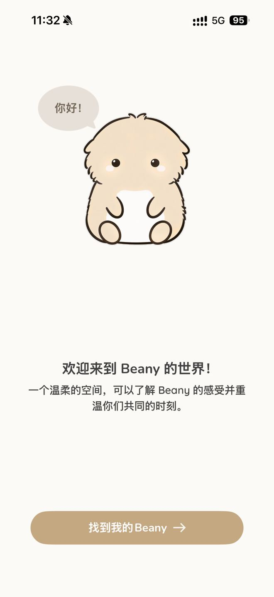

**IMG_1299.PNG · 选择设备**

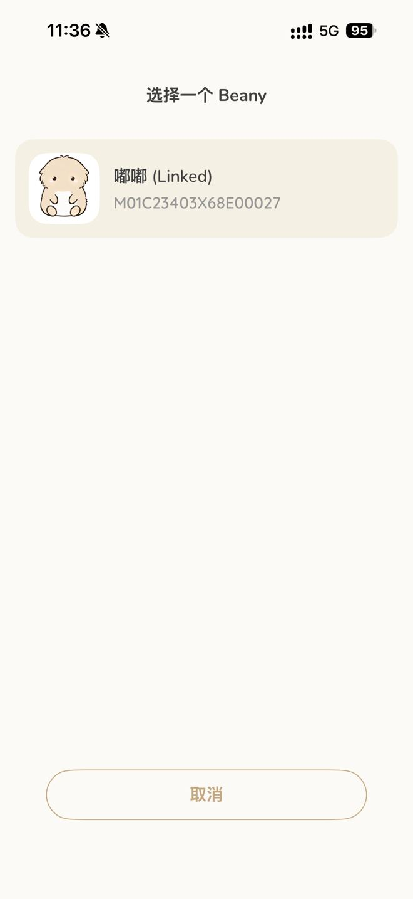

**IMG_1300.PNG · 重复绑定风险确认弹窗**

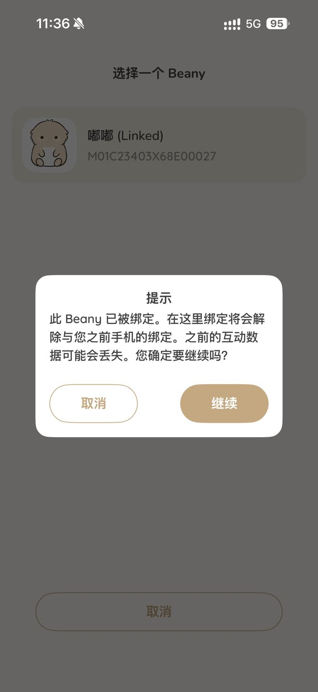

**IMG_1301.PNG · 设备侧配对确认等待**

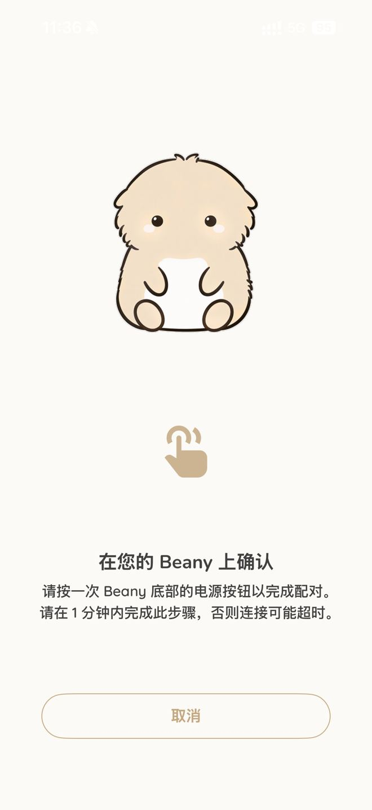

**IMG_1302.PNG · 宠物首页（内容未解锁示例）**

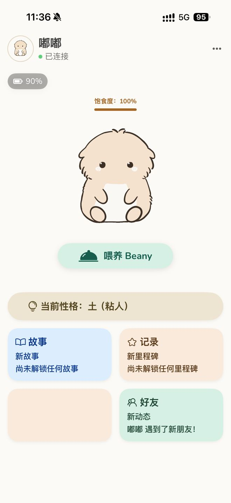

**IMG_1303.PNG · 宠物首页 / 更多菜单展开**

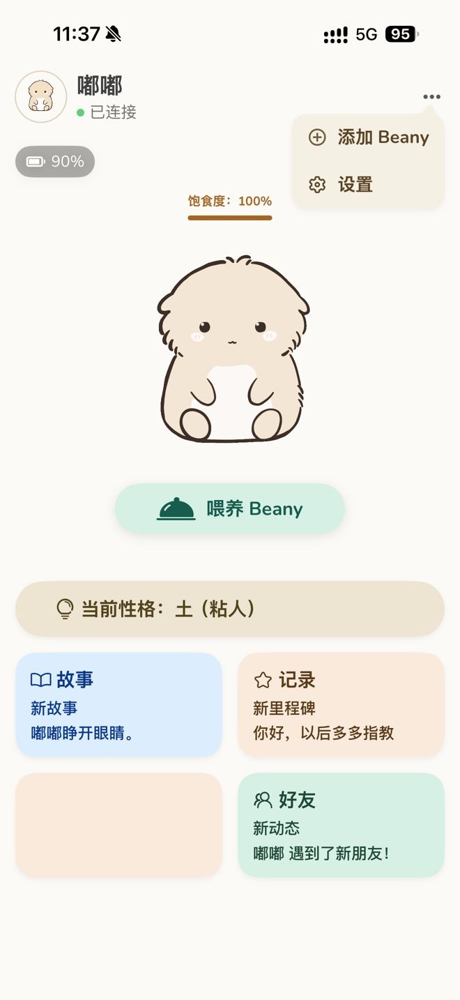

**IMG_1304.PNG · 添加设备 / 开机准备弹窗**

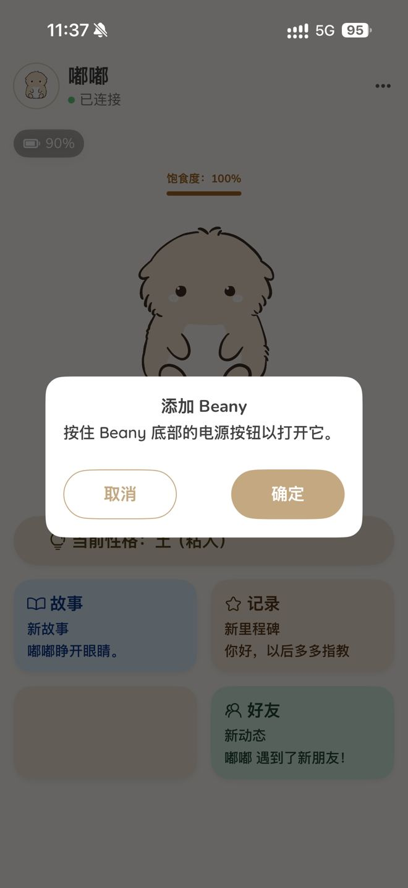

**IMG_1305.PNG · 设置（上半页）**

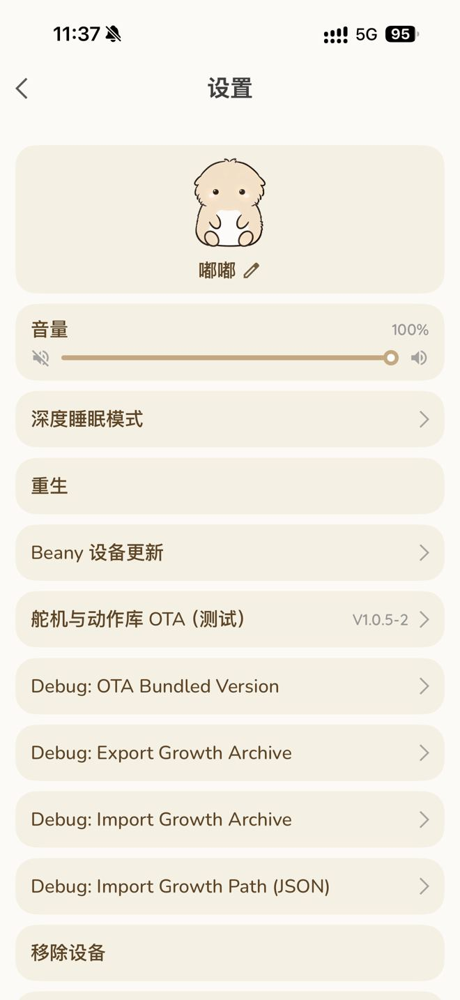

**IMG_1306.PNG · 设置（下半页，与 IMG_1305 同页续图）**

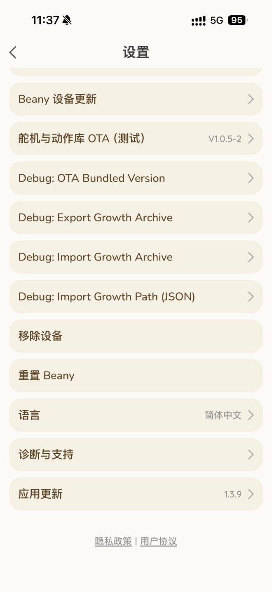

**IMG_1307.PNG · 首页／宠物主页**

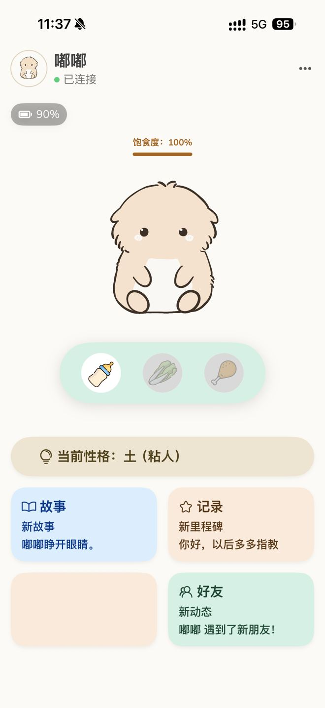

**IMG_1308.PNG · 个性**

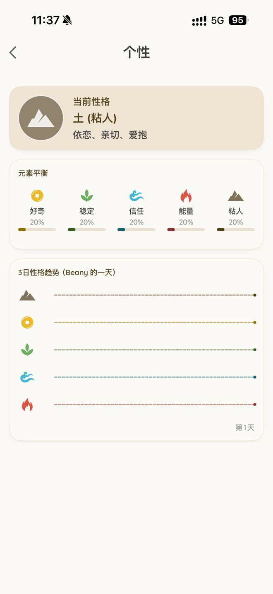

**IMG_1311.PNG · 好友**

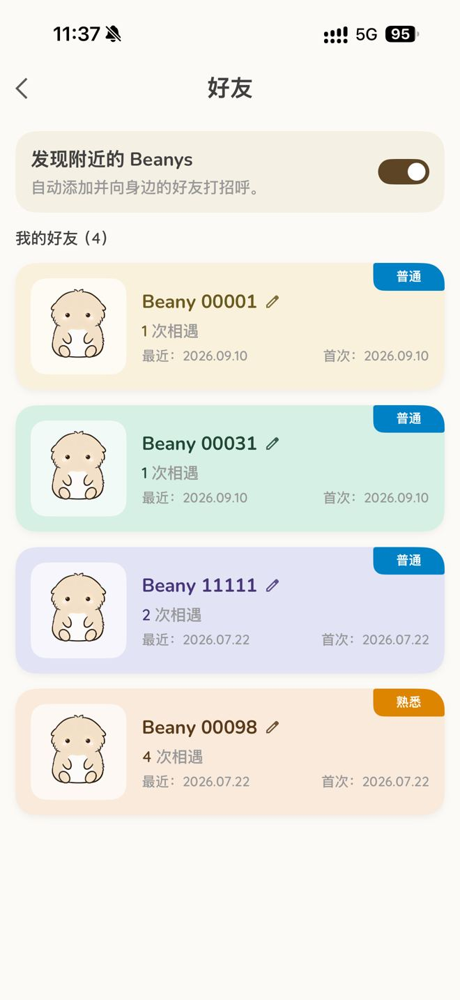

**IMG_1312.PNG · 故事**

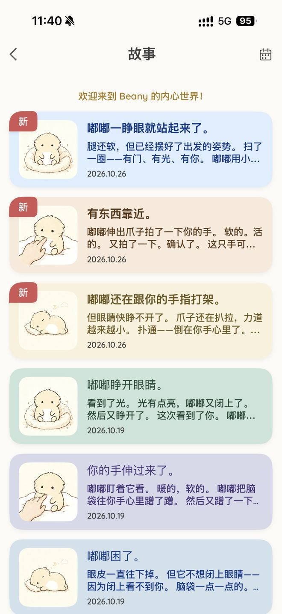

**IMG_1313.PNG · 记录／里程碑时间轴**

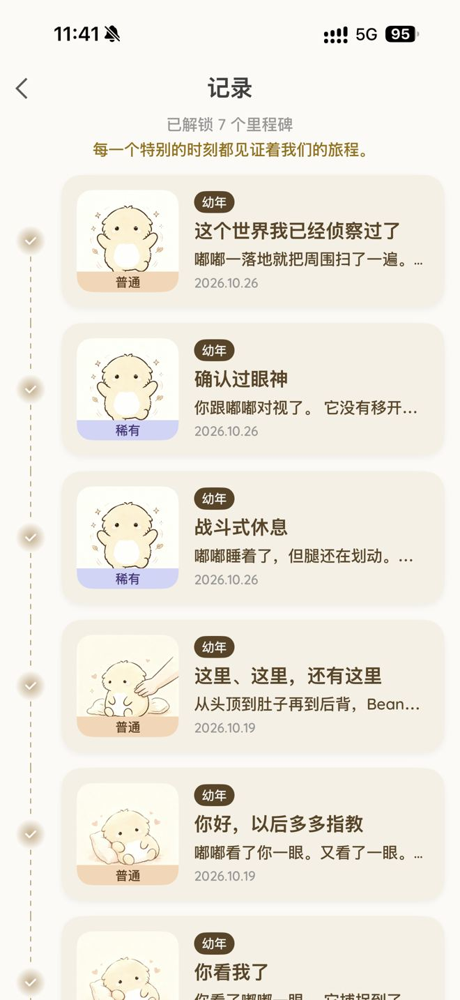

**IMG_1317.PNG · 深度睡眠模式**

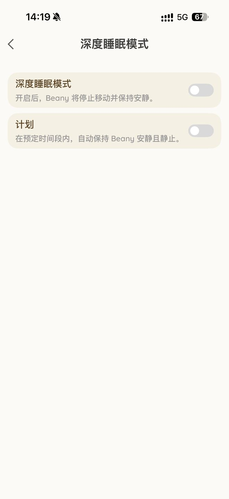

**IMG_1319.PNG · 故事详情**

**IMG_1320.PNG · 里程碑详情**

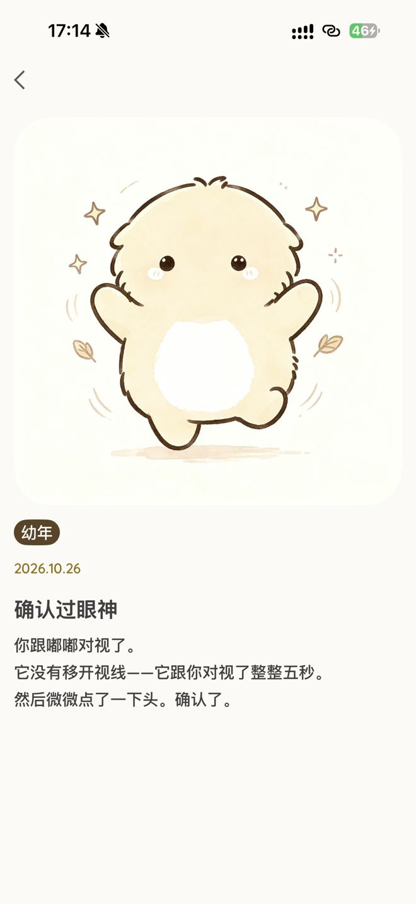

**IMG_1322.PNG · 个性与五维能量分布（新增状态）**

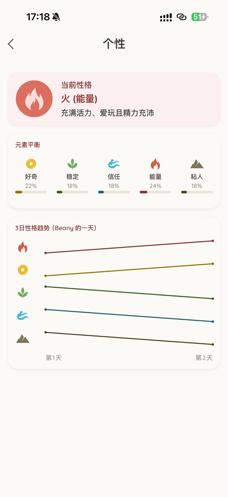

[返回完整PRD目录](../README.md) · [上一章](./03-app-protocol.md) · [下一章](./05-emotion.md)
