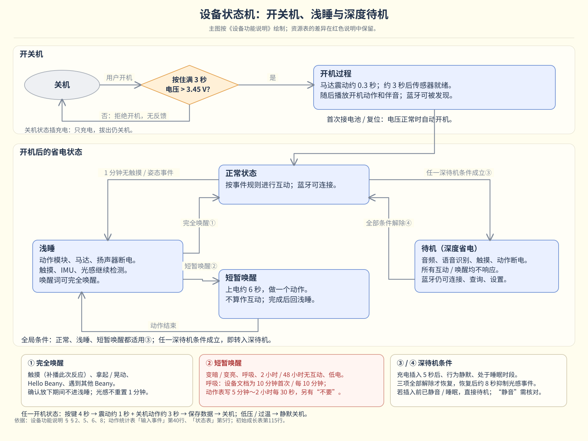
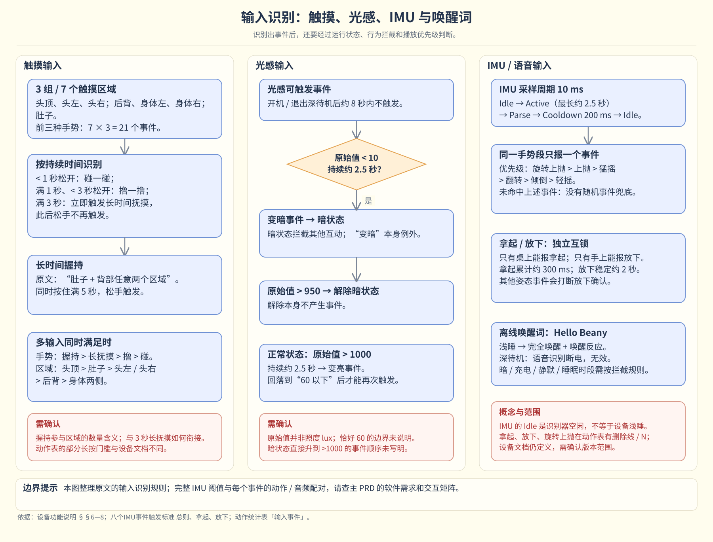
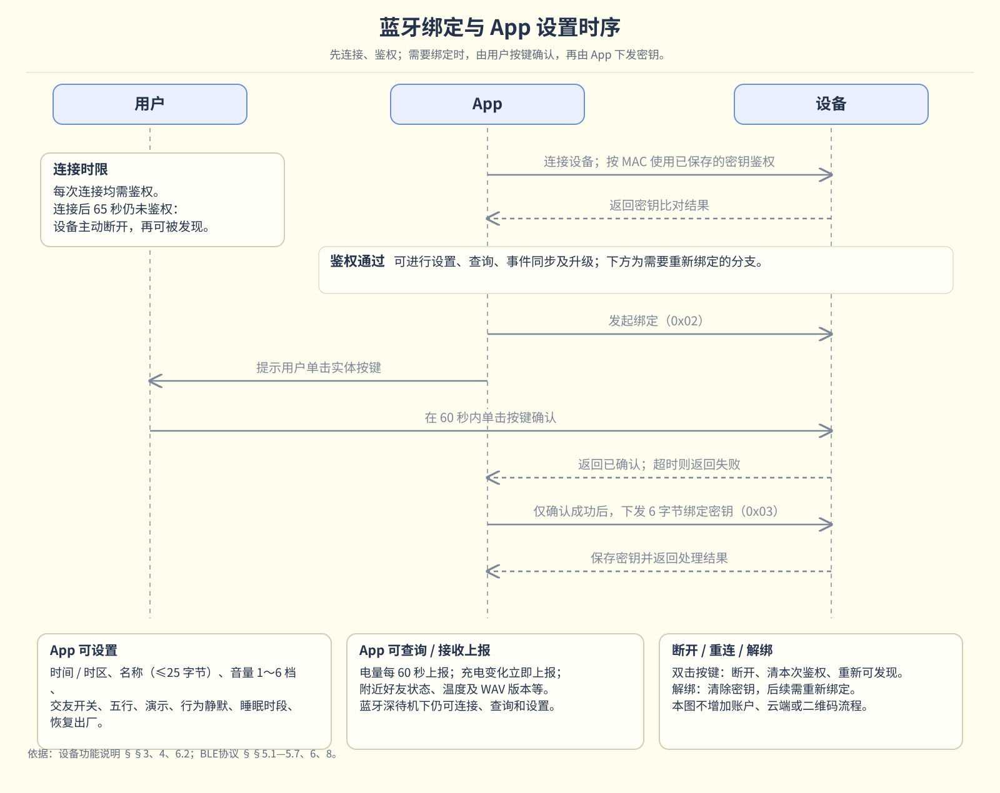
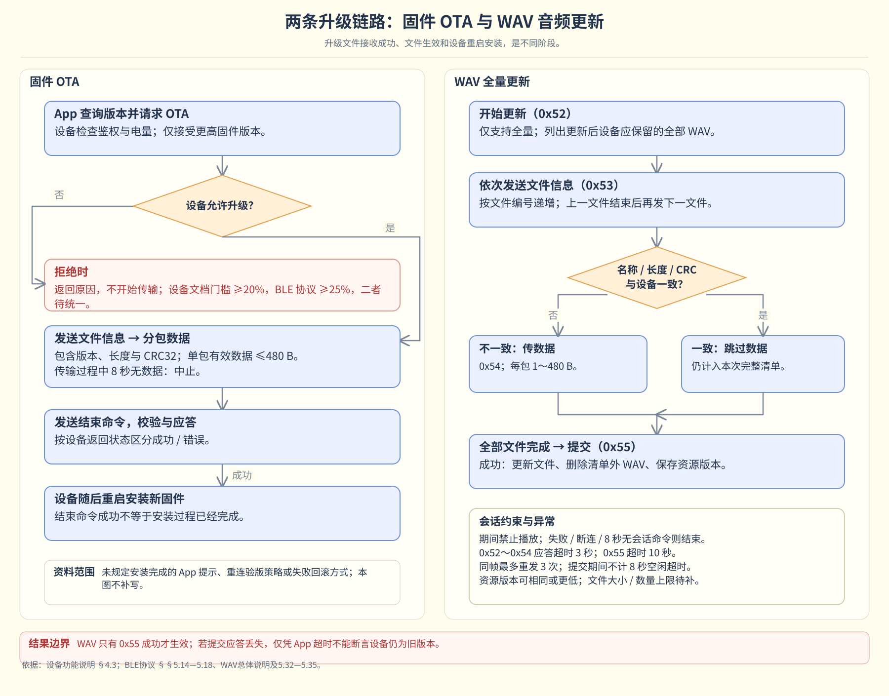
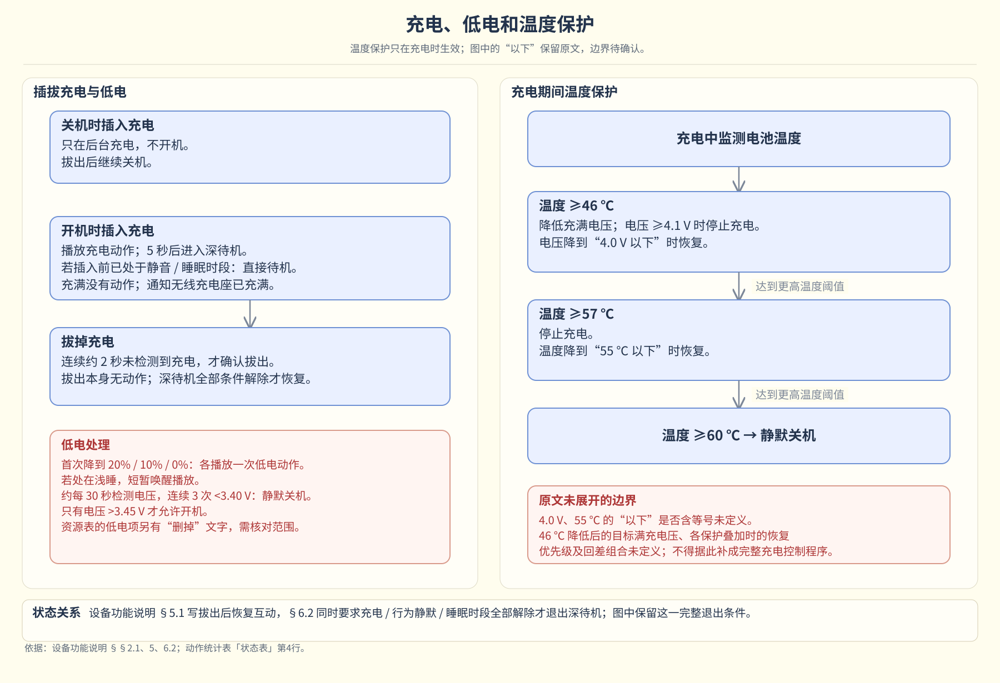
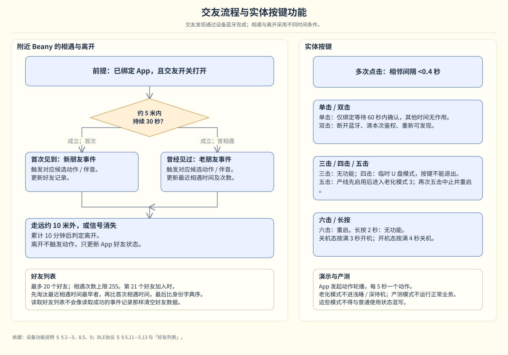

# 13 状态与功能流程

[返回完整PRD目录](../README.md) · [上一章](./12-interaction-matrix.md) · [下一章](./14-resource-mapping.md)

设备状态控制能否响应；App业务控制何时更新和保存。

**设备状态机 · 沿用资料中的开关机、浅睡与深度待机条件**

**一次互动的输出路径**

1. 输入识别→事件ID
2. 检查状态、启用、去重与优先级
3. 有效自定义绑定：直接执行；否则检查模式
4. 初始：初始表ANY；成长：生效阶段表＋情绪分组
5. 按组内权重一次抽取完整候选
6. 解析动作/伴音/震动资源并执行；高优先级可中断

**首次连接与成长启用**

1. 读取是否已初始化
2. 未初始化：准备主五行、五维100×5、XP0、初识包
3. 核验资源与现有用户绑定
4. 分别提交并回读核对
5. 全成功：建立事件起点/好友基线，进入初识；否则继续显示未完成

**成长更新与阶段切换**

1. App发起查询
2. 事件去重落盘后ACK；好友表确认增量
3. 累计五维和XP→生成目标阶段
4. 检查资源、候选和当前绑定
5. App提交并逐项回读
6. 确认后切换阶段；结果不明先查询，不冒称旧包或新包已生效

**里程碑与故事闭环**

1. 获取已确认互动/好友增量/包生效证据
2. 判断当前档案里程碑条件
3. 首次满足保存唯一里程碑记录
4. 冻结名称、日期、证据和模板版本
5. 生成唯一故事→列表→详情→已读
6. 失败重试同一篇，不重复奖励或生成

**自定义动作与实际互动**

1. 选择1–3张已验证卡片并排序
2. 名称1–12字、停顿0/0.5/1秒、总时长≤5秒
3. 可预览/停止，预览不记成长
4. 保存并回读确认作品
5. 另行绑定普通轻触ID并确认
6. 真实触摸100%执行用户序列，获准事件记1次成长

设备输入、绑定、升级与保护子流程

**输入识别：触摸、光感、IMU 与唤醒词**

**蓝牙绑定与 App 设置时序**

**两条升级链路：固件 OTA 与 WAV 音频更新**

**充电、低电和温度保护**

**交友流程与实体按键功能**

[返回完整PRD目录](../README.md) · [上一章](./12-interaction-matrix.md) · [下一章](./14-resource-mapping.md)
